 <p align="center">
  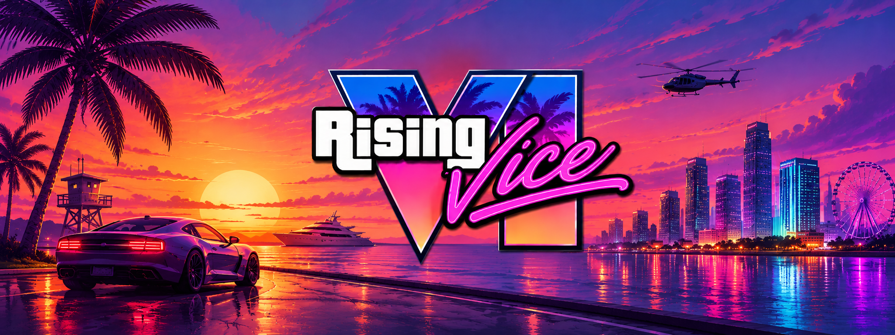
</p>

<h1 align="center">RisingVice</h1>

<p align="center">
  
  
  
  
  
  
  
  
  
</p>

An experimental Xbox Series X emulator for Windows, developed primarily for **Grand Theft Auto VI (GTA VI)** compatibility research, with a focus on NVIDIA GPU support.

RisingVice aims to make GTA VI playable on Windows PCs equipped with **NVIDIA GeForce RTX 30, 40 and 50 Series graphics cards**.

It maps a title's own executable, binds its imports and runs it within an Xbox Series inspired software environment on the host GPU.

> [!IMPORTANT]
> **RisingVice ships no game data.** You supply your own copy of the title; nothing from the game lives in this repository, and the tools refuse to write inside it.
>
> **Primary target:** Grand Theft Auto VI (GTA VI).
>
> **Main goal:** Make GTA VI playable on Windows using NVIDIA GeForce RTX 30, 40 and 50 Series GPUs.
>
> **Current state:** Successfully boots, loads into gameplay and supports limited character movement at approximately **2–4 FPS**.
>
> **Rendering:** Character models, clothing and environment geometry are visibly rendered. Shader support and lighting remain incomplete.
>
> **Target:** 30 FPS at 2560x1440.

---

## About

RisingVice is an experimental Xbox Series X emulator for Windows, with GTA VI as its primary compatibility research target.

The project focuses on bringing Xbox Series software compatibility to NVIDIA-powered Windows PCs, with the long-term goal of making GTA VI playable across GeForce RTX 30, 40 and 50 Series graphics cards.

It does not emulate the console hardware instruction by instruction. Instead, it maps the title's own executable into memory, resolves its imports against platform modules written in Rust, and forwards graphics work to the host GPU through Direct3D 12.

The design has three layers:

• **Loader.** Reads the title's PE images, maps them, applies relocations and binds every import. If anything is missing, it says so before the title runs.

• **HLE.** Hand-written implementations of the system modules the title calls: kernel, file access, storage, networking, audio, input and the graphics front end.

• **GPU.** Command stream translation onto the host D3D12 device, including memory management, resource layouts and descriptor heaps.

Everything is built from files the user supplies. No game data is stored or distributed with this project.

## Screenshots

Screenshots captured during GTA VI compatibility testing using RisingVice.

<details>
<summary><strong>01–04 · Boot and Loading Screens</strong></summary>

### 01 · Account Picker Screen

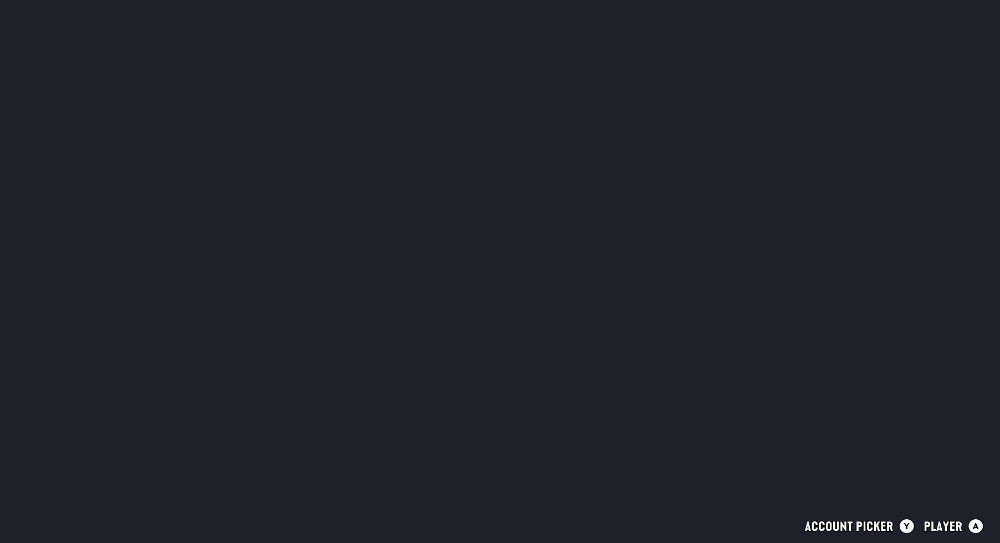

### 02 · Game Opening Artwork

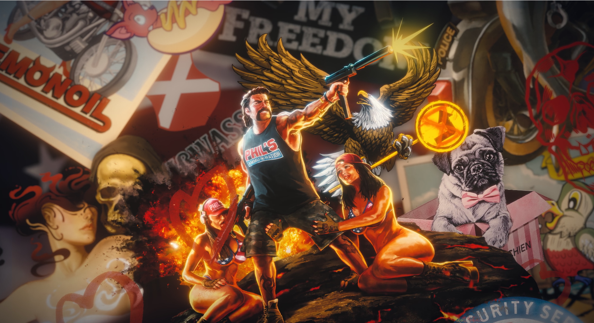

### 03 · Loading Artwork · Blue Car

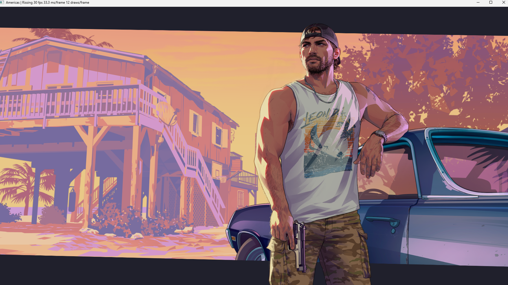

### 04 · Loading Artwork · Character

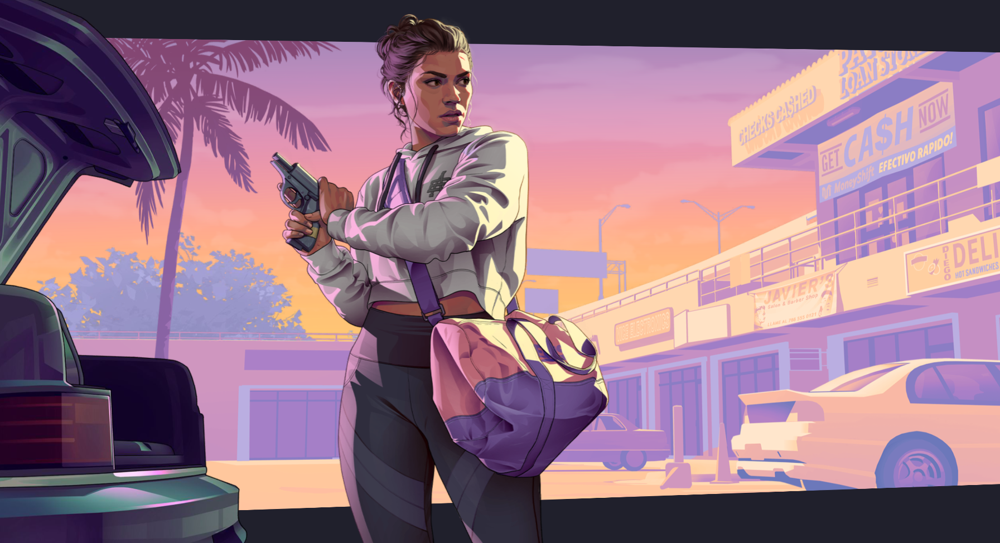

</details>

<details>
<summary><strong>05–08 · Gameplay and In-Game Rendering</strong></summary>

### 05 · Nighttime Street Scene

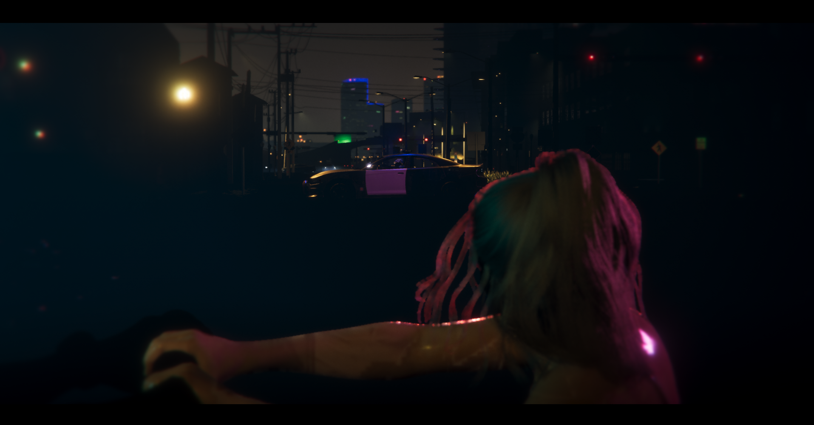

### 06 · Character Interaction

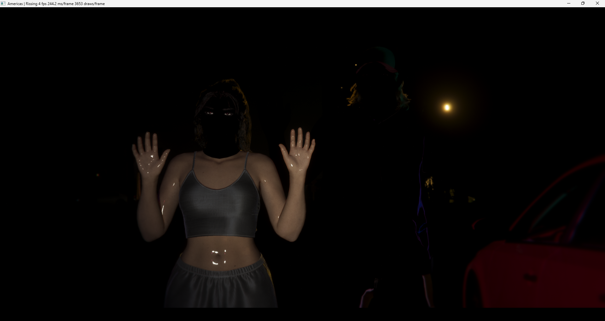

### 07 · Opening Credits Scene

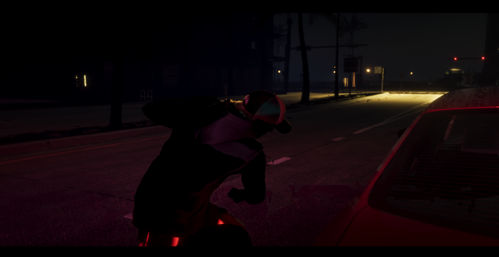

### 08 · Sunset Character Art

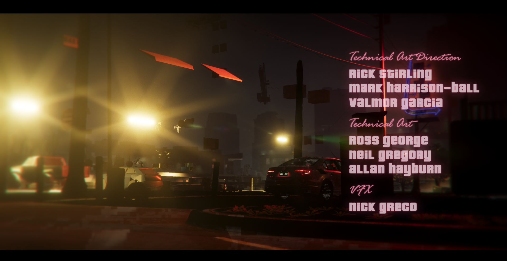

</details>

<details>
<summary><strong>09–11 · Featured Gameplay Screenshots</strong></summary>

### 09 · Cinematic Credits Scene

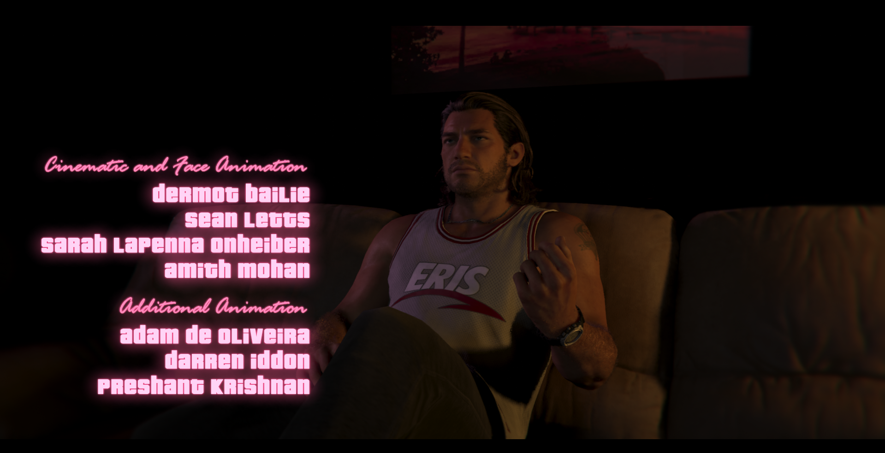

### 10 · Indoor Character Scene

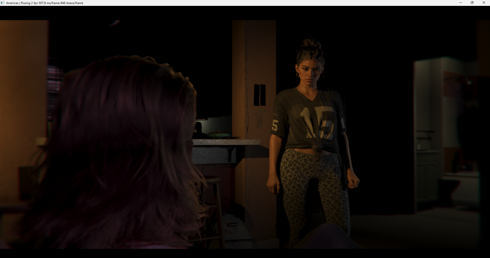

### 11 · Couch Scene

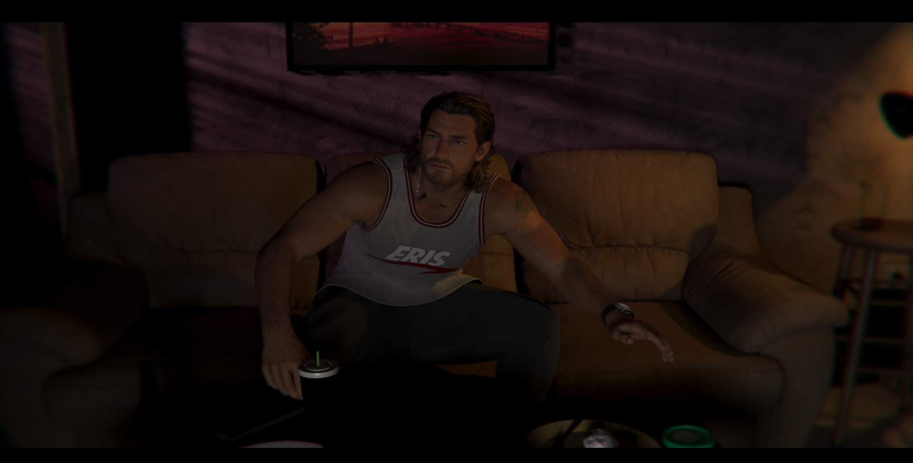

</details>

<details>
<summary><strong>12 · First Interactive Gameplay</strong></summary>

### Blue Car Character Art

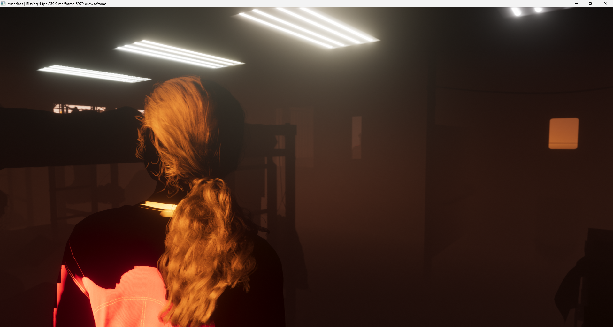

RisingVice successfully reaches interactive gameplay, allowing limited character movement within the game world at approximately **2–4 FPS**.

This represents an important development milestone: the emulator is no longer limited to booting and displaying scenes. Actual gameplay interaction is possible.

</details>

> [!NOTE]
> Rendering remains experimental. Shader support, lighting, graphical accuracy, stability and performance are still under development. All screenshots show actual emulator output.

## Status

| Setting | Value |
|---|---|
| Primary target | Grand Theft Auto VI (GTA VI) |
| Console profile | Xbox Series X |
| GPU target | NVIDIA GeForce RTX 30, 40 and 50 Series |
| Tested GPU | RTX 3070 (8 GB) |
| Machine | Ryzen 7 7700X, RTX 3070 (8 GB), 32 GB DDR5, Windows 11 |
| Boot | Successful |
| Loading | Successfully reaches the game |
| Gameplay | Interactive, limited character movement |
| Latest gameplay performance | Approximately 2–4 FPS |
| Previous measured performance | 3.9 to 6.8 FPS steady, 12.4 FPS peak |
| Shaders | Incomplete |
| Lighting | Not fully implemented |
| Target | 30 FPS at 2560x1440 |
| Development stage | Experimental, in development |

## Frame rate

Measured on the RTX 3070. Full notes in [`docs/risingvice-notes.md`](docs/risingvice-notes.md).

| Configuration | FPS | Notes |
|---|---:|---|
|  `Default` | 3.5 to 5.3 | Right after a fresh build |
| `RISSING_CARD_BUFFERS_MIN_MB=1` | **3.9 to 6.8**, peak 12.4 | Best previous steady benchmark |
| `+ RISSING_ASYNC_PRESENT=1` | 2.5 to 10.6 | Spiky: higher peaks, lower floor |
| `RISSING_RELAY=2` | 30 | Menus only; never reaches the world |
| `RISSING_DISPLAY_MODE=1920x1080` | 3.1 to 4.1 | No gain. The cost is not fill rate |
|  `Latest interactive gameplay` | **2 to 4** | Limited character movement |

A world frame takes 200 to 280 ms in the previous measurements:

• 90 to 290 ms copying back into title memory (25 to 96 MB).

• 70 to 195 ms on the GPU, often idle.

• 40 to 200 ms preparing uploads and buffer copies.

Memory sits at about 6.9 GB of the 7 GB usable.

## Progress

### Fixed: integer render targets

`integer_format()` and `blend_for()` in `crates/Rissing-gpu/src/pipeline/host.rs` disable blending where D3D12 refuses it. Mesh pipeline refusals went from **17 to 1**, and textured geometry now draws.

### Gameplay milestone

RisingVice has progressed beyond booting and presenting frames.

• Successfully reaches the boot and loading sequences.

• Loads into actual gameplay.

• Character models and parts of the surrounding environment render.

• Limited character movement is possible at approximately 2–4 FPS.

• Gameplay scenes can be rendered and captured through the emulator.

### Ruled out

1. CPU copy-back scan: about 1 ms per frame.
2. Scattered copy-back ranges: already merged.
3. Compute pipelines with empty bytecode: none, 2 KB to 337 KB.
4. Compute pipelines missing samplers: same counts as working ones.
5. Lower resolution: no change at 1080p.
6. `RISSING_RELAY=2` for world frames: menus only.

### Still open

| Issue | Detail |
|---|---|
| 7 compute pipelines refused | `E_INVALIDARG`, valid bytecode, no message from D3D12 |
| Shader support | Incomplete shader translation |
| Lighting | Not fully implemented |
| Graphical accuracy | Materials and lighting need further work |
| Performance | Gameplay currently around 2–4 FPS |
| 8 GB VRAM | Exhausted before 2560x1440 becomes possible |

## Build and run

```sh
cargo build --release
cp rissing.example.toml rissing.toml   # set game_dir, must be outside this repo

# bind only, no window
./target/release/Rissing.exe run '<Title>.exe'

# run
RISSING_CARD_BUFFERS_MIN_MB=1 ./target/release/Rissing.exe run '<Title>.exe' --execute
```

Toolchain is pinned in `rust-toolchain.toml`.

### Requirements

| Requirement | Minimum |
|---|---|
| OS | Windows 10 or 11, 64 bit |
| GPU | NVIDIA, Direct3D 12 capable. 8 GB VRAM supported, the target needs more |
| CPU | Any x86-64 with SSE4.2 |
| RAM | 16 GB tested at the low end, 32 GB recommended |
| Rust | 1.88 or newer, pinned by `rust-toolchain.toml` |
| Game data | Not included. You must obtain your own copy of the title |

### Command line

The `Rissing` binary has these commands:

| Command | What it does |
|---|---|
| `inspect` | Summarise one PE image: headers, sections, imports, TLS, build id |
| `census` | Aggregate the imports of every image under the given paths |
| `lib-exports` | List the `dll!export` pairs an import library describes |
| `shader-info` | Find shader containers and report their layout |
| `translate` | Run every shader through the translator and report what fails |
| `run` | Prepare, map and bind a title executable. With `--execute`, run it |
| `config` | Show the resolved configuration and check it |

### Settings

| Variable | Default | Effect |
|---|---|---|
| `RISSING_GAME_DIR` | none | Where the title lives. Required |
| `RISSING_CACHE_DIR` | `%LOCALAPPDATA%\Rissing\cache` | Derived data |
| `RISSING_DATA_DIR` | `%LOCALAPPDATA%\Rissing\data` | Saved data from the title |
| `RISSING_CARD_BUFFERS_MIN_MB` | unset | `1` is the best previous steady frame rate found |
| `RISSING_ASYNC_PRESENT` | unset | `1` raises peaks and lowers the floor |
| `RISSING_DISPLAY_MODE` | title default | `1920x1080` to override resolution |
| `RISSING_LOG` | none | Log filter, for example `Rissing_gpu=trace,info` |

## Layout

| Path | Contents |
|---|---|
| `crates/Rissing-core` | Config, paths, asset policy, logging |
| `crates/Rissing-pe` | PE/COFF parsing |
| `crates/Rissing-loader` | Title mapping and import binding |
| `crates/Rissing-hle` | Platform modules the title calls |
| `crates/Rissing-gpu` | D3D12 streams and GPU memory |
| `crates/Rissing-shader` | Shader translation |
| `crates/Rissing-formats` | Texture and audio formats |
| `crates/Rissing-pipeline` | Draw pipelines |
| `crates/Rissing-game` | Title-side helpers |
| `apps/Rissing` | CLI front end |
| `docs/` | Architecture, asset policy, measurements |
| `screenshots/` | Boot, loading and gameplay screenshots |

See [`docs/architecture.md`](docs/architecture.md) and [`docs/asset-policy.md`](docs/asset-policy.md).

---

## Credits

This project uses code from these repositories:

• AMD addrlib (as shipped in Mesa), for texture layouts.

• FFmpeg, for WMA Pro audio decoding.
